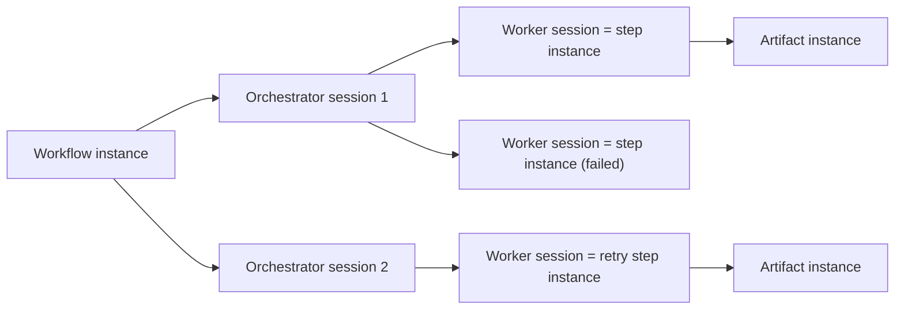

# Session model

{: .no_toc }

The harness separates **definitions** (configuration) from **executions**, and attributes every execution to an **orchestrator session** or a **worker session** that the host observed.

## Table of contents

{: .no_toc .text-delta }

1. TOC
{:toc}

---

## Definitions and executions

| Definition (configuration) | Execution | Identity |
|---|---|---|
| **Workflow** — an atomic, artifact-delivering unit of the methodology, made of steps; it declares the orchestrator that drives it | **Workflow instance** — one dated run of one workflow | `workflowInstanceId`, minted by `resolve-step` |
| **Step** — a configured unit of work: actor, skills, instructions, artifact kind, conditions, capability weights | **Step instance** — one execution of a step within a workflow instance; a retry is a new step instance | the `sessionId` of its worker session; nothing else is minted |
| **Artifact kind** — a schema slug, for example `epic` or `feature` | **Artifact instance** — one file at one workspace path, valid against its kind's schema | its workspace path |

A workflow never nests another workflow. It is atomic but not transactional: the step instance, not the workflow instance, is the unit of acceptance.

## Orchestrator and worker sessions

An orchestrator or worker session is a span of one framework agent's work, observed by the host and registered by the harness (`start-session`). Its identity comes from the host, never from the model, and it owns one log file. There are two kinds:

- An **orchestrator session** is performed by an orchestrator agent. It receives the workflow instructions and skills when it opens, converses with you, asks the harness for steps and dispatches them. It drives **at most one** workflow instance; an orchestrator session that ends before your assent drives none.
- A **worker session** is performed by a dispatched agent, the step's actor. It executes **exactly one** step instance, and is that step instance: 1 step instance = 1 agent = 1 worker session = 1 artifact instance.

Each worker session records its orchestrator session as `parentSessionId`. An orchestrator session has no parent.

How host events map to orchestrator and worker sessions is each adapter's to define. On both supported hosts, an orchestrator session is **one turn**: it opens when you prompt an orchestrator and ends when the orchestrator returns to you. A worker session opens at each dispatch and ends when the actor returns.

## Cardinalities

- A workflow instance spans one or more orchestrator sessions, one after another, plus one worker session per step instance. The next orchestrator session **continues** a half-finished workflow instance; it never replaces it.
- An orchestrator session never spans two workflow instances: no log ever carries entries of two workflow instances.
- A step has zero or more step instances per workflow instance (retries). Only its passing step instance is promoted, so in workspace state each step delivers exactly one artifact instance.

## How the workflow instance is deduced

No agent ever passes or mints a workflow instance id. `resolve-step` receives only the workflow slug, then:

- continues the **latest open workflow instance** of that workflow (one not all of whose steps have a passing step instance); or
- opens a new workflow instance when none is open.

A new workflow instance of the same workflow opens only after the previous one reached `no-next-step` and you ask for the workflow again. Older open workflow instances simply stop being the latest; abandonment is not a state.

## The identity chain

`workflowInstanceId` → `stepSlug` → step instance (the worker session's `sessionId`) → its commits (that `sessionId` in each commit message) → its step ref `refs/harness/steps/<workflowInstanceId>/<stepSlug>/<workerSessionId>`.

## Logs

Each orchestrator or worker session owns one append-only file, `<workspace>/logs/<sessionId>.log.jsonl`. Its first entry is the `start-session` registration; each later function call of that orchestrator or worker session appends one entry, and `end-session`, when the host lets the adapter observe the end, appends the last one. A workflow instance owns no file: its history is the ordered union of the entries carrying its id across the logs. Logs are local to your machine; agents never write them.
