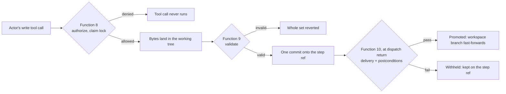

# Write governance

{: .no_toc }

The workspace is a Git repository, and **workspace state is its committed state**: the checked-out branch (`HEAD`), which the harness calls the workspace branch. Agents write in the working tree; the harness decides what becomes workspace state. Every artifact write happens inside a governed step instance, lands first on that step instance's own **step ref**, and enters workspace state only when the step instance passes and is **promoted**. These are the **step transactions** of the harness.

## Table of contents

{: .no_toc .text-delta }

1. TOC
{:toc}

---

## The path of one write

## Authorization (function 8)

Before every write, the hook asks `check-step-authorization` for each target path, with the action (`create`, `update` or `delete`) derived from the host's write tool. The framework's access-control list (`conf/access-control-list.conf.yaml`) decides:

- **Roles** are framework-defined sets of privileges. A privilege is exactly one artifact kind (a schema slug) plus one action.
- **Actors** map one or more roles to one framework agent, named by the `name` in its `.agent.md` frontmatter.
- **Whole-resource.** The resource is the artifact kind, resolved from the path through the workspace layout; paths and properties are not modeled.
- **No implicit grants.** A write is denied unless a role of the acting agent grants that action on that kind.
- **Reads are not modeled.** Agents may read anything.

A denied tool call never runs, and the adapters also deny a write tool call whose target paths they cannot extract. Every denial is a journaled `denied` outcome whose `failureMessage` names its cause:

| Cause | Why |
|---|---|
| missing privilege | no role of the actor grants the action on the kind |
| `delete` | deleting governed artifacts is unsupported in v1, whatever the roles grant; so is an `apply_patch` move, which implies a delete |
| unresolvable resource | the path is outside the artifact layout, or not workspace-relative (absolute, drive, UNC, `..`) |
| logs path | the logs are harness-authored; no role can grant them |
| no step in flight | the write comes from an orchestrator session, from a worker session without its own step ref, or after its step instance concluded |
| unclean baseline | an unclaimed path is modified or untracked in the working tree, compared with `HEAD` |
| artifact lock held | another step instance holds the path's lock; the message names its workflow instance and step |

## Artifact locks

Once every other check admits the write, function 8 claims the path's **artifact lock**, the ref `refs/harness/locks/<artifactPath>`, whose value names the holding step ref. The claim is a create-only ref update, so it is atomic.

- The write is admitted when the claim succeeds, when this step instance already holds the lock, or when an unpromoted earlier step instance of the same step in the same workflow instance holds it (a retry). A retry re-points the lock to its own step ref.
- A lock whose holding step instance was promoted counts as released.
- A claimed lock persists until its step instance is promoted, even if function 9 later reverts the write.

Writes are therefore exclusive per artifact instance until promotion.

## Validation and commit (function 9)

After every write, `check-step-artifact` validates the staged bytes of **every path of the tool call** against their artifact schemas, as one set:

- **`valid`** — the whole set is committed as **one commit onto the step ref**, built with a temporary index and `git commit-tree`. `HEAD`, the working tree and the workspace's index never move, and anything else already staged in the index stays out of the commit. The commit message carries the worker session's `sessionId`. The report records `commitId` and `committedPaths`; a set identical to the step ref tip commits nothing (`commitId: null`).
- **`reverted`** — any invalid path discards the **whole set**. Each path is restored from the step ref when the step ref changed it, else from `HEAD` when it is tracked there, else deleted. The report lists each failing path with its failure message and its revert; the adapter tells the actor what was restored, from where, so it can rewrite correctly.

No commit ever holds invalid bytes, and no partial set ever commits. Markdown artifacts are validated through their YAML frontmatter (the body is prose no schema constrains); `.yaml` and `.yml` artifacts are read as YAML in the JSON data model.

## Step refs

A **step ref**, `refs/harness/steps/<workflowInstanceId>/<stepSlug>/<workerSessionId>`, carries one step instance's validated commits. `start-session` creates it when it registers the worker session, without any checkout:

- from the tip of the step's previous, unpromoted step instance in the same workflow instance (a retry) when the workspace branch has not moved since that step instance's base, so the retry continues the failed work;
- otherwise from the workspace branch tip.

Step refs are never renamed, reused or deleted: each one is the audit trail of its step instance, promoted or not.

## Promotion (function 10)

When the dispatch returns, `check-step-postconditions` runs in the orchestrator session, on the step instance's step ref:

1. **Rebase.** If the workspace branch moved since the step ref's base, the harness rebases the step instance's commits onto the branch tip in memory (`git merge-tree --write-tree`). A path changed on both sides is a conflict: `step-rebase-conflict`, and the step instance concludes not executed.
2. **Evaluate** the **step state** (the workspace branch plus the step instance's commits):
   - **delivery** — the step state changes **exactly one** artifact instance of the step's declared kind, and the worker session's own commits change that same artifact instance. Delivery is a harness invariant, not a condition: it cannot be configured or switched off, and a write identical to the step ref tip does not deliver;
   - every declared **postcondition**, in the [condition language]().
3. **On pass, promote.** One atomic compare-and-swap fast-forwards the workspace branch to the step ref tip. **This ref update is the acceptance point.** If the branch moved in between, the compare-and-swap fails with `step-rebase-conflict`. After acceptance, the harness syncs the index entries of the promoted paths and deletes the step instance's locks, best-effort.
4. **On fail, withhold.** The workspace branch, the index and the locks are untouched; only the step ref may have moved, by the rebase. A retry inherits the locks and the work.

The report carries `artifactDelivery` and `promotion` (`{outcome: promoted | withheld, workspaceCommit}`). Workspace state therefore advances once per passing step instance, to exactly the state that was evaluated.

## What each step instance sees

| Plane | Guarantee |
|---|---|
| Writes | exclusive per artifact instance until promotion (artifact locks) |
| Postconditions | evaluated on the latest workspace branch, at promotion |
| Harness reads | committed state only: the workspace branch, or the step state for function 10 |
| Agent reads | free; an agent may see another step instance's unpromoted bytes in the working tree |

Preconditions are checked at dispatch and not re-checked at promotion. Concurrent workflow instances are not a goal of this release, but step instances on different artifact instances can coexist safely on one clone: their writes never share a path, and their promotions serialize on the compare-and-swap.

## When the hooks do not fire

A host whose hook fails open (a timeout, a hook that fails to spawn) can let a write or a dispatch bypass a check. The guarantees are then narrower:

- **A write that bypassed authorization** lands in the working tree without an artifact lock. If no later hook runs on it, it stays uncommitted, and the dirtied path fails the clean-baseline check for every later governed write to it while it is unclaimed. If the write-ended hook still runs, function 9 validates it and, when it is valid, commits it onto the step ref: function 9 does not re-check authorization or the lock.
- **Function 9 commits a path's working-tree bytes.** A change made outside the file-edit tools, for example through the shell, to a path the step instance holds is swept into that path's next validated commit.
- **Commits made by hand on the workspace branch bypass promotion entirely.** The harness checks only the writes it mediates. A hand commit that changes a locked path makes the next promotion fail with `step-rebase-conflict`.

What still holds: function 9 never commits invalid bytes, and only a step instance that passes delivery and its postconditions is promoted. After a hook failure, inspect the workspace before you continue: `git status` for working-tree changes, `git for-each-ref refs/harness/` for step refs and held locks, and `git log` on the step ref for what it committed. A guarantee on the shared branch needs a required CI check that validates every committed artifact; the harness does not ship one in this release.

An abandoned workflow instance keeps its artifact locks until it resumes, or until a person deletes the lock ref and restores the path in the working tree. There are no timeouts. The internal sweep of the store (a capability for tooling such as a CI check, not a function) reports every step ref, every held lock with its holder, and every working-tree change without a lock.
