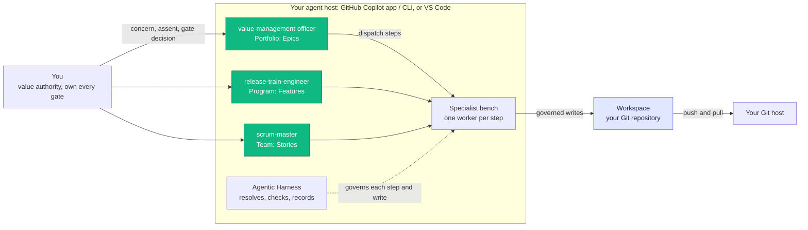

# SAF — the Systemic Agentic Framework

{: .no_toc }

The **Systemic Agentic Framework (SAF)** is a governed, local-first way to run **SAFe** with AI agents. Portfolio, program and team workflows run on your own machine, inside your agent host — the GitHub Copilot app or Copilot CLI, or VS Code with GitHub Copilot Chat — and produce schema-validated SAFe artifacts (Epics, Features, Stories, ADRs, kanbans, gate records) in a Git repository you own. Every workflow ends at a human gate: agents draft, challenge and rewrite; the decision stays with you.

**Status.** The [Agentic Harness]() is at **v1.0.0-alpha.1**, a pre-release. The [SAFe Agentic Organization]() is used from its `main` branch. Installation is manual; marketplace distribution is planned.

SAF complements **[OIP]()** and is designed to integrate with **[SIE]()**: its artifact templates can be sourced as GSM Archetypes, and the planned [SIE Bridge]() turns its execution history into GSM contributions.

## The framework's architecture

Four properties make it work:

1. **Local-first** — the agent loop runs on your machine, in your agent host, against a real Git working tree. Work state stays in your files; only what you push leaves through your Git host. (Model calls go to your agent host's model provider.)
2. **Governed** — three layer orchestrators and a specialist bench, with a human gate at the end of every workflow. The harness resolves every step, authorizes and validates every write, and only accepts a step that delivered its artifact.
3. **Sovereign** — work state lives in your own files and Git history, not in a vendor's cloud. Nothing is trapped in an unmanaged chat.
4. **Portable** — the harness is methodology- and host-agnostic: plain files, a fixed set of twelve functions, and host specifics isolated in thin adapters. Two hosts are supported today; the same workflows run on both.

You talk to the orchestrator of the layer your concern belongs to. A concern of another layer's grain is a handoff: the orchestrator tells you which orchestrator to invoke.

*Each orchestrator drives one workflow at a time and returns its main artifacts to you at the gate. The full model is on the **[SAFe Agentic Organization]()** page.*

---

## Get started

- **[Quickstart]()** — install the harness and the organization for the GitHub Copilot app / Copilot CLI or for VS Code.
- **[Running workflows]()** — run a first workflow, continue it, recover an interrupted workflow instance.

## Products

- **[Agentic Harness]()** — the deterministic execution core: it resolves workflow steps, models and the context of orchestrator and worker sessions, checks conditions, authorization and artifacts, governs every write through step transactions, and journals every step.
  - [Features]() — the capability catalogue with milestones
- **[SAFe Agentic Organization]()** — the SAFe-shaped framework application the harness executes: orchestrators, the specialist bench, skills, workflows, instructions, and artifact schemas.
  - [Features]() — the capability catalogue with milestones
- **[Agentic Workspace]()** — the shared data plane storing the artifacts local agentic workflows produce. *Documentation in construction.*
  - [Features]() — the capability catalogue with milestones
- **[SIE Bridge]()** — the client sourcer turning the harness-governed agentic-execution history into GSM contributions on the Blackboard Manager. *Documentation in construction.*
  - [Features]() — the capability catalogue with milestones

**Next: [Quickstart →]()**
{: .fs-5 .fw-300 }
