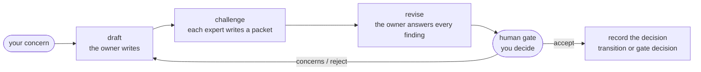

# SAFe Agentic Organization
{: .no_toc }

The **SAFe Agentic Organization** is the SAFe framework application the [Agentic Harness]() executes: **Full SAFe** as an agentic organization, with the four layers (Portfolio, Large Solution, ART, Team), 38 agents, 61 workflows and 34 artifact kinds. It is not one agent that "does Scrum". It is a *distributed* system: SAFe governance is split across specialized agents, **every main artifact is challenged by experts with real IT jobs before a human decides on it**, and the work state is externalized to committed artifacts in a Git repository. We call this model **Distributed Agentic SAFe**, to contrast it with *centralized* agentic, where a single monolithic agent tries to hold the whole lifecycle in one context window.

This page describes the organization's `main` branch. The [Quickstart]() installs it as the Copilot plugin `poesis-saf-agentic-organization`. Its repository is [`poesis-cloud/saf-agentic-organization`](https://github.com/poesis-cloud/saf-agentic-organization); the roster, the workflow catalog and the artifact kinds are listed in its [catalog](https://github.com/poesis-cloud/saf-agentic-organization/blob/main/docs/catalog.md), and how each SAFe role, event and artifact maps onto it in its [SAFe conformance](https://github.com/poesis-cloud/saf-agentic-organization/blob/main/docs/safe-conformance.md).

## Table of contents
{: .no_toc .text-delta }

1. TOC
{:toc}

---

## Centralized vs. distributed

| Axis | Centralized agentic | **Distributed Agentic SAFe** |
|---|---|---|
| Orchestration | one monolithic agent owns the whole lifecycle | **4 layer orchestrators**, SAFe role authors and an expert bench |
| Context | a single shared memory | **no shared memory**: committed artifacts are the bus; each step gets a small fixed context |
| State | implicit, in-chat, lost on reset | **externalized** as committed artifacts; Git history is the event log |
| Execution | the agent decides what to do next | the **harness resolves every step**; one worker per step, one artifact per step |
| Quality | the author reviews its own work | **independent experts challenge** every main artifact; the owner must answer each finding |
| Models | one model does everything | **deterministic per-step routing** by capability score |
| Human control | ad hoc, easy to bypass | a **human gate at the end of every workflow**; the human is the value authority |
| Scaling | vertical (bigger prompt, bigger context) | **horizontal** (divide and conquer, one item at a time) |

---

## The challenge loop

Most workflows (36 of 61) are **challenge loops**. The owner of an artifact drafts it, a panel of experts each writes one challenge packet, the owner answers every finding, and a human decides.



- **The owner** is a SAFe role (Epic Owner, Product Manager, System Architect, Product Owner…) or, for a craft artifact, the expert whose job it is (the DevOps Engineer writes the delivery pipeline map).
- **The experts** are real IT jobs. Each reads the draft through its own lens (a Security Expert asks about trust boundaries and abuse cases; a Site Reliability Engineer about service level objectives and rollback; a Data Protection Officer about lawful basis and retention) and writes findings: a claim, its evidence, the smallest change that would resolve it, and a verdict (`pass`, `concerns`, `blocking`, `not-applicable`). An expert never edits the artifact it challenges.
- **The owner answers.** Every finding is accepted, rejected with a reason or deferred to a named place, in the artifact's `challengeLedger`.
- **You decide.** The orchestrator shows you the artifact, the verdict of each expert, and the findings the owner rejected or deferred, with both positions.

The harness enforces the loop on committed state, so it does not depend on a prompt being followed: a packet must target the artifact drafted in the same run, the owner must revise that artifact and answer every packet, and a gate decision that accepts an artifact is refused unless an expert challenged it.

---

## The orchestrators

You talk to one orchestrator per layer. Each writes, or thickens, work items of **its layer's grain**, inside the matching SAFe activity:

| Orchestrator | Layer | Grain | What reaches your gate |
|---|---|---|---|
| `value-management-officer` | Portfolio | Epic (business or enabler) | Strategic Themes, Portfolio Vision, value streams, Epics, Lean Business Cases, Lean Budgets, Portfolio Roadmap, Architecture Vision |
| `solution-train-engineer` | Large Solution | Capability (business or enabler) | Solution Train canvas, Solution Vision, Solution Intent, Capabilities, Solution Roadmap, supplier agreements, Solution Train PI Objectives |
| `release-train-engineer` | ART | Feature (business or enabler) | ART canvas, Product Vision, PI Roadmap, Features, architecture decisions, NFRs, delivery pipeline, PI Objectives, releases |
| `scrum-master` | Team | Story (user or enabler) | Team charter, Stories, iteration plans, code changes |

A concern of another layer's grain is a **handoff**: the orchestrator tells you which orchestrator to invoke, and never mints a thinner item to absorb a thicker intent. Each layer works alone: Essential SAFe needs only the ART and Team orchestrators; add the Large Solution orchestrator when several ARTs build one solution, and the Portfolio orchestrator when you fund value streams.

Orchestrators hold no Epic, Capability, Feature or Story privilege. They act the flow records of their own events (event records, Kanban boards, gate decisions), and every state change of an item is one run of a `*-transition` workflow whose owner step records it.

## The agents

38 agents: 4 orchestrators, 9 SAFe roles that author artifacts, and 25 experts. Each has a compact identity and one craft skill: how to author the artifacts it owns, and what to ask of each artifact it challenges.

### SAFe roles

| Agent | Role |
|---|---|
| `portfolio-manager` | Portfolio Manager: the Lean Portfolio Management author. Drafts Strategic Themes, the Portfolio Vision and canvas, the Portfolio Roadmap, Lean Budgets with their guardrails and value stream definitions for Portfolio Leadership to decide. |
| `epic-owner` | Epic Owner of the business Epics: authors the Epic hypothesis, its Lean Business Case and MVP, evaluates the MVP for the pivot-or-persevere decision, and records Epic state changes after Portfolio Leadership decided. |
| `enterprise-architect` | Enterprise Architect: authors the Architecture Vision, leads the enabler Epics as their Epic Owner, and challenges portfolio artifacts for runway, reuse across value streams and technical feasibility. |
| `business-owner` | Business Owner view on the bench. Challenges themes, visions, Epics, budgets, roadmaps and PI Objectives for return on investment, governance, compliance and risk trade-offs, so that the human Business Owners can decide fast. |
| `solution-manager` | Solution Manager of the Solution Train. Authors the Solution Vision, the Solution Roadmap and business Capabilities with benefit hypothesis, acceptance criteria and WSJF; records their state changes; challenges enabler Capabilities. |
| `solution-architect` | Solution Architect: authors the Solution Intent and the enabler Capabilities, and challenges solution artifacts and enabler Epics for a shared technical direction across ARTs and suppliers. |
| `product-manager` | Product Manager of the ART. Authors the Product Vision, the PI Roadmap and business Features with benefit hypothesis, acceptance criteria and WSJF; records Feature state changes after the human decided. |
| `system-architect` | System Architect of the ART. Authors enabler Features, architecture decisions and the NFR register; challenges the ART canvas, Product Vision, PI Roadmap, business Features and PI Objectives for architecture, runway and NFR impact. |
| `product-owner` | Product Owner of the team. Authors Stories with user voice and acceptance criteria, owns the Team Backlog content, records Story state changes after the human decided, and challenges the team charter and the iteration plan. |

### The expert bench

Real IT jobs, each sitting on the panels where its lens matters.

| Family | Experts |
|---|---|
| Engineering | `software-engineer`, `quality-engineer`, `devops-engineer`, `platform-engineer`, `database-administrator`, `data-engineer`, `ai-engineer`, `systems-engineer` |
| Operations | `site-reliability-engineer`, `observability-engineer`, `release-manager` |
| Security, privacy, compliance, legal | `security-expert`, `data-protection-officer`, `compliance-officer`, `legal-counsel` |
| Finance and sourcing | `financial-controller`, `finops-engineer`, `procurement-manager` |
| Product, design and content | `ux-designer`, `accessibility-specialist`, `product-marketing-manager`, `technical-writer` |
| Business and practice | `business-analyst`, `data-analyst`, `agile-coach` |

For example, a Feature is drafted by the Product Manager and challenged by the System Architect, Software Engineer, Quality Engineer, Security Expert, UX Designer and Data Protection Officer. A release is drafted by the Release Manager and challenged by the Site Reliability Engineer, Observability Engineer, Security Expert, Quality Engineer, Technical Writer and Product Marketing Manager.

---

## How you work with it

1. **Any concern, any form.** You state a concern; you don't name a ceremony. The orchestrator maps it to the one workflow of its layer whose SAFe purpose matches, or hands you to another orchestrator. A concern that matches no catalog purpose is not a usecase here: IT concerns (impact, bug, spike, debt, decision) map onto an existing activity at Epic, Capability, Feature or Story grain.
2. **Workflows are challenge loops** (above), **transitions** (the owner records your decision as a state change), **events** (a SAFe event is recorded) or **gate decisions** (your decision on an artifact with no state is recorded).
3. **The human gate.** Each workflow delivers its main artifact to you. You accept, raise concerns, or reject; a rejection reiterates the workflow as a new workflow instance. Challenge packets and records are evidence, not what you are asked to judge.
4. **No valid step without artifact.** Every step commits a change to exactly one artifact instance of its declared kind, whatever the outcome, and records its decision in that artifact's `stepOutcomes`. Agent replies are indicative; committed artifacts are the only evidence.

How a run unfolds, step by step, is on [Running workflows]().

### Step outcomes

Each step appends one entry to the artifact it commits:

```yaml
stepOutcomes:
  - step: feature-refinement/revise      # <workflow-slug>/<step-slug>
    outcome: revised     # written | revised | confirmed | no-change | none
    date: "2026-11-21"
    note: Accepted 4 findings, rejected 1 (out of scope for this PI), deferred 1 to nfr-refinement.
    friction: The NFR register has no accessibility entry yet.   # optional
```

| Outcome | Meaning |
|---|---|
| `written` | the artifact was created |
| `revised` | its content changed |
| `confirmed` | reviewed and still valid, content unchanged |
| `no-change` | out of scope on this run, deliberately untouched (a refused state change, for example) |
| `none` | not needed; the artifact records that decision |

The appended entry guarantees a change, so `confirmed` and `no-change` steps still deliver. `friction` is raw input for Inspect and Adapt and the Iteration Retrospective, which read it.

---

## The workflow catalog

61 workflows, grouped by layer: 36 challenge loops, 11 transitions, 10 event records and 4 gate decisions, at most 8 steps each. The **gate artifact** is what is presented at the human gate; a transition's owner step and a gate decision record your decision.

### Portfolio: `value-management-officer`

| Workflow | Purpose | Gate artifact | Challenge panel | Steps |
|---|---|---|---|---|
| `strategic-themes` | Formulate or revise the portfolio's Strategic Themes as Objectives and Key Results that connect the portfolio to the enterprise strategy. | `strategic-themes` | `enterprise-architect`, `business-owner`, `financial-controller`, `data-analyst` | 6 |
| `portfolio-vision` | Describe the future state of the portfolio's value streams and solutions, from the current-state portfolio canvas to the future-state one. | `portfolio-vision` | `enterprise-architect`, `business-analyst`, `business-owner` | 5 |
| `value-stream-definition` | Define one development value stream: the operational value streams it supports, its solutions and customers, the trains that realize it, and its KPIs. | `value-stream` | `business-analyst`, `enterprise-architect`, `agile-coach` | 5 |
| `epic-hypothesis` | Capture or thicken one business Epic as an Epic hypothesis statement, ready for Portfolio Leadership to review. | `epic` | `enterprise-architect`, `business-owner`, `data-analyst` | 5 |
| `epic-enabler-hypothesis` | Capture or thicken one enabler Epic (runway, platform, exploration or compliance) as an Epic hypothesis ready for Portfolio Leadership to review. | `epic-enabler` | `solution-architect`, `platform-engineer`, `business-owner`, `finops-engineer`, `data-analyst` | 7 |
| `lean-business-case` | Analyze one Epic in the analyzing state: define its MVP, estimate its cost and projected value, and recommend go or no-go. | `lean-business-case` | `enterprise-architect`, `financial-controller`, `security-expert`, `data-protection-officer`, `legal-counsel` | 7 |
| `epic-enabler-lean-business-case` | Analyze one enabler Epic under analysis: its MVP, its cost and the value it unlocks for the Epics it enables, ending in go or no-go. | `lean-business-case` | `solution-architect`, `financial-controller`, `finops-engineer`, `security-expert`, `legal-counsel` | 7 |
| `epic-mvp-evaluation` | Evaluate the MVP of one implementing Epic against its hypothesis and recommend to persevere, pivot or stop. | `epic` | `data-analyst`, `business-owner`, `financial-controller` | 5 |
| `epic-enabler-mvp-evaluation` | Evaluate the MVP of one implementing enabler Epic against its hypothesis and recommend to persevere, pivot or stop. | `epic-enabler` | `data-analyst`, `business-owner`, `financial-controller` | 5 |
| `portfolio-roadmap` | Build or revise the multi-year view of how the Portfolio Vision will be achieved across the value streams. | `portfolio-roadmap` | `enterprise-architect`, `financial-controller`, `product-marketing-manager` | 5 |
| `strategic-investment-planning` | Establish or update Lean value stream budgets and their guardrails for the coming budget period (formerly Participatory Budgeting). | `lean-budgets` | `financial-controller`, `enterprise-architect`, `business-owner`, `finops-engineer` | 6 |
| `architecture-vision` | Establish or revise the portfolio's technology vision, strategy and roadmap, and the architectural runway it needs. | `architecture-vision` | `solution-architect`, `security-expert`, `platform-engineer`, `data-engineer`, `finops-engineer` | 7 |
| `epic-transition` | Record the human's decision to move one Epic to a new Portfolio Kanban state, then re-render the Portfolio Kanban. | `epic` | — | 2 |
| `epic-enabler-transition` | Record the human's decision to move one enabler Epic to a new Portfolio Kanban state, then re-render the Portfolio Kanban. | `epic-enabler` | — | 2 |
| `portfolio-sync` | Inspect the flow of Epics and the portfolio's operations between Strategic Portfolio Reviews, and re-render the Portfolio Kanban. | `event-record` | — | 2 |
| `strategic-portfolio-review` | Review whether the portfolio is achieving its vision and themes, and record the funding and direction decisions Portfolio Leadership takes. | `event-record` | — | 1 |
| `portfolio-gate-decision` | Record the human's decision on a challenged portfolio-level artifact that has no state of its own (an artifact with a state moves with its transition workflow). | `gate-decision` | — | 1 |

### Large Solution: `solution-train-engineer`

| Workflow | Purpose | Gate artifact | Challenge panel | Steps |
|---|---|---|---|---|
| `solution-train-launch` | Define or revise one Solution Train: its mission, ARTs and suppliers, roles and cadence. | `solution-train-canvas` | `agile-coach`, `solution-architect`, `business-analyst` | 5 |
| `solution-vision` | Describe the future state of the large solution: customer and stakeholder needs and the proposed solution. | `solution-vision` | `solution-architect`, `business-owner`, `ux-designer`, `product-marketing-manager` | 6 |
| `solution-roadmap` | Forecast the solution's deliverables: a PI roadmap (one committed PI, two forecast) and a multi-year view. | `solution-roadmap` | `solution-architect`, `systems-engineer`, `release-manager` | 5 |
| `solution-intent` | Record what the solution must do and how it is designed: fixed and variable intent, interfaces, NFRs, standards, verification and traceability. | `solution-intent` | `systems-engineer`, `security-expert`, `compliance-officer`, `data-protection-officer`, `site-reliability-engineer` | 7 |
| `capability-refinement` | Write or thicken one business Capability so it is ready for Pre-Plan: benefit hypothesis, acceptance criteria, WSJF and the Features each ART would take. | `capability` | `solution-architect`, `systems-engineer`, `security-expert`, `compliance-officer` | 6 |
| `capability-enabler-refinement` | Write or thicken one enabler Capability that extends the runway of the large solution, so it is ready for Pre-Plan. | `capability-enabler` | `solution-manager`, `systems-engineer`, `security-expert`, `compliance-officer`, `platform-engineer` | 7 |
| `supplier-engagement` | Write or revise the agreement that brings one supplier into the Solution Train's cadence, quality expectations and compliance obligations. | `supplier-agreement` | `legal-counsel`, `security-expert`, `compliance-officer`, `financial-controller`, `solution-architect` | 7 |
| `supplier-agreement-transition` | Record the human's decision on one supplier agreement as a state change. | `supplier-agreement` | — | 1 |
| `pre-plan` | Align and prepare the ARTs and suppliers of the Solution Train for PI Planning. | `event-record` | — | 1 |
| `solution-train-pi-planning` | Aggregate the ARTs' PI plans into the Solution Train's PI Objectives, planning board and risks for one PI. | `pi-objectives` | `solution-manager`, `solution-architect`, `systems-engineer`, `business-owner` | 6 |
| `coordinate-and-deliver` | Keep the ARTs and suppliers aligned during the PI (Product Manager Sync, Architect Sync, RTE Sync) and re-render the Solution Train Kanban. | `event-record` | — | 2 |
| `solution-demo` | Give stakeholders an integrated view of what the ARTs and suppliers built in the PI, as objective evidence, and collect their feedback. | `event-record` | — | 1 |
| `solution-train-inspect-and-adapt` | Evaluate the integrated solution and the train's way of working at the end of the PI, and derive improvement backlog items. | `event-record` | `agile-coach`, `data-analyst` | 4 |
| `capability-transition` | Record the human's decision to move one Capability to a new Solution Train Kanban state, then re-render the Solution Train Kanban. | `capability` | — | 2 |
| `capability-enabler-transition` | Record the human's decision to move one enabler Capability to a new Solution Train Kanban state, then re-render the Solution Train Kanban. | `capability-enabler` | — | 2 |
| `solution-gate-decision` | Record the human's decision on a challenged solution train-level artifact that has no state of its own (an artifact with a state moves with its transition workflow). | `gate-decision` | — | 1 |

### ART: `release-train-engineer`

| Workflow | Purpose | Gate artifact | Challenge panel | Steps |
|---|---|---|---|---|
| `art-launch` | Define or revise one Agile Release Train: its mission, teams, roles and PI cadence. | `art-canvas` | `agile-coach`, `system-architect`, `product-manager`, `business-analyst` | 6 |
| `product-vision` | Describe the future state of the solution the ART develops: customers, their needs and the features proposed to meet them. | `product-vision` | `system-architect`, `ux-designer`, `business-owner`, `product-marketing-manager` | 6 |
| `product-roadmap` | Forecast the ART's deliverables: the committed PI and the next two as a forecast. | `product-roadmap` | `system-architect`, `business-owner`, `release-manager` | 5 |
| `feature-refinement` | Write or thicken one business Feature so it is ready for PI Planning: benefit hypothesis, acceptance criteria and WSJF. | `feature` | `system-architect`, `software-engineer`, `quality-engineer`, `security-expert`, `ux-designer`, `data-protection-officer` | 8 |
| `feature-enabler-refinement` | Write or thicken one enabler Feature that extends the architectural runway or improves the delivery pipeline. | `feature-enabler` | `product-manager`, `software-engineer`, `platform-engineer`, `devops-engineer`, `observability-engineer`, `security-expert` | 8 |
| `architecture-decision` | Take one architecture decision that Features need: context, options kept open, the decision proposed and its consequences. | `adr` | `software-engineer`, `security-expert`, `platform-engineer`, `data-engineer`, `ai-engineer` | 7 |
| `adr-transition` | Record the human's decision on one architecture decision as a state change. | `adr` | — | 1 |
| `nfr-refinement` | Create or revise the ART's register of nonfunctional requirements: each one bounded, measurable and verifiable. | `nfrs` | `site-reliability-engineer`, `observability-engineer`, `security-expert`, `quality-engineer`, `accessibility-specialist`, `ai-engineer` | 8 |
| `delivery-pipeline` | Map the ART's Continuous Delivery Pipeline from ideation to on-demand release, find its bottlenecks and propose the enablers that remove them. | `delivery-pipeline` | `platform-engineer`, `security-expert`, `quality-engineer`, `site-reliability-engineer`, `finops-engineer`, `compliance-officer` | 8 |
| `pi-planning` | Plan one PI for the ART: team and ART PI Objectives, the planning board and the PI risks. | `pi-objectives` | `product-manager`, `system-architect`, `software-engineer`, `business-owner` | 6 |
| `release-on-demand` | Plan one release and assemble its readiness evidence: what is made available to which customers, how, and how its outcome will be measured. | `release` | `site-reliability-engineer`, `observability-engineer`, `security-expert`, `quality-engineer`, `technical-writer`, `product-marketing-manager` | 8 |
| `release-transition` | Record the human's decision on one release as a state change: released, rolled back or cancelled. | `release` | — | 1 |
| `art-sync` | Inspect the ART's progress toward its PI Objectives (Coach Sync and PO Sync combined), handle dependencies and impediments, and re-render the ART Kanban. | `event-record` | — | 2 |
| `system-demo` | Show the integrated work of all teams for the iteration from a production-like environment, as an objective measure of progress, and collect feedback. | `event-record` | — | 1 |
| `inspect-and-adapt` | Evaluate the PI's result and the ART's way of working at the end of the PI, and derive improvement backlog items. | `event-record` | `agile-coach`, `data-analyst` | 4 |
| `feature-transition` | Record the human's decision to move one business Feature to a new ART Kanban state, then re-render the ART Kanban. | `feature` | — | 2 |
| `feature-enabler-transition` | Record the human's decision to move one enabler Feature to a new ART Kanban state, then re-render the ART Kanban. | `feature-enabler` | — | 2 |
| `art-gate-decision` | Record the human's decision on a challenged art-level artifact that has no state of its own (an artifact with a state moves with its transition workflow). | `gate-decision` | — | 1 |

### Team: `scrum-master`

| Workflow | Purpose | Gate artifact | Challenge panel | Steps |
|---|---|---|---|---|
| `team-formation` | Define or revise one Agile team: its mission, members, working agreements, Definition of Done and Kanban. | `team-charter` | `agile-coach`, `product-owner`, `quality-engineer` | 5 |
| `story-refinement` | Write or thicken one Story so it is ready for Iteration Planning: user voice, acceptance criteria and an estimate. | `story` | `software-engineer`, `quality-engineer`, `security-expert`, `ux-designer` | 6 |
| `iteration-planning` | Plan one iteration: the iteration goals, the Stories selected and the capacity behind them. | `iteration-plan` | `product-owner`, `software-engineer`, `quality-engineer` | 5 |
| `story-implementation` | Implement one ready Story test-first in its code repository and record the change with its evidence; experts review it before the human merges. | `code-change` | `quality-engineer`, `security-expert`, `observability-engineer`, `database-administrator`, `accessibility-specialist` | 7 |
| `team-sync` | Inspect progress toward the iteration goals, adjust the plan for the coming day, and re-render the Team Kanban. | `event-record` | — | 2 |
| `iteration-review` | Inspect the iteration increment with stakeholders, assess progress toward the iteration goals and PI Objectives, and adjust the Team Backlog. | `event-record` | — | 1 |
| `iteration-retrospective` | Review the team's practices at the end of the iteration and choose the improvements to try next. | `event-record` | — | 1 |
| `story-transition` | Record the human's decision to move one Story to a new Team Kanban state, then re-render the Team Kanban. | `story` | — | 2 |
| `code-change-transition` | Record the human reviewer's decision on one code change as a state change. | `code-change` | — | 1 |
| `team-gate-decision` | Record the human's decision on a challenged team-level artifact that has no state of its own (an artifact with a state moves with its transition workflow). | `gate-decision` | — | 1 |

Some workflows carry harness-checked [conditions]() beyond the loop itself: an Epic becomes `ready` only with a Lean Business Case recommending go; a Capability, Feature or Story splits only from an approved parent; PI Planning needs a `ready` Feature, Iteration Planning a `ready` Story; no backlog item moves past the human's go before it was challenged; a Story is accepted only when its code change is `merged`.

---

## Enablers

SAFe enablers extend the architectural runway or improve the value stream. They have their own kinds and owners, in the same backlog folders, Kanban boards and states as their business siblings: `epic-enabler` (written by the `enterprise-architect`, who acts as its Epic Owner), `capability-enabler` (the `solution-architect`) and `feature-enabler` (the `system-architect`). A Story of type `enabler` is written by the team; its enabler type is `exploration`, `architecture`, `infrastructure` or `compliance`.

---

## Model routing

Each step declares capability weights (deep reasoning, coding, tool use, long context, writing quality, instruction following, schema adherence, …). The harness scores the organization's model catalog (`conf/model-profiles.conf.yaml`) against them and returns a canonical model profile; each host adapter maps it to a host model. Both adapters refuse, at every hook load, a catalog slug they do not bind.

## Repository layout

The repository root is host-agnostic source; the installable artifact is a bundle rendered per host.

| Folder | Content |
|---|---|
| `agents/` | the agents, one compact identity each (`<name>.agent.md`) |
| `skills/` | one craft skill per agent: its authoring guide and its lens on each artifact it challenges |
| `instructions/` | what the harness injects: the step contract, the step patterns and the orchestrator duties in `shared/`; one brief per workflow and one catalog per orchestrator in `portfolio/`, `solution/`, `art/`, `team/` |
| `workflows/` | the workflow catalog, by layer |
| `conf/` | `access-control-list` (least privilege: one role per agent), `model-profiles`, `workspace` (where each artifact lives) |
| `artifacts/` | artifact JSON Schemas, by layer |
| `templates/` | artifact templates, by layer |
| `builds/` | the organization model and its generator (`model/`) and the Copilot plugin renderer (`plugin/`) |
| `docs/` | usage model, catalog, step artifacts, SAFe conformance |

The artifact schemas, templates, workflows, briefs, catalogs, access control list and workspace layout are generated from the model in `builds/model/` (`make generate`); agents, skills and shared instructions are hand-written.

---

## Planned: sync with central systems

The organization does not sync with central systems on `main`: you share the workspace by pushing its branch to your Git host. The intended model mirrors the committed artifacts to the systems your organization runs, with clear authority:

| Concern | Authority | Direction |
|---|---|---|
| Content (title, body, WSJF, risk, parent, estimates) | **local** wins | push overwrites the board projection |
| Status (non-gate board columns) | **remote** wins | pull writes the board column back to frontmatter |
| **Gate-crossing moves** (an item leaving refinement, approval, release, `→ done`) | **neither** | never auto-applied; recorded as a request for you to decide |

Because the artifacts are template-shaped and schema-validated, such a sync can emit textbook SAFe (the Epic → Capability → Feature → Story hierarchy, WSJF, acceptance criteria, PI assignment, dependencies) to a Git host, a ticketing system (Jira) or a knowledge base (Confluence), instead of anyone hand-typing cards.

## Build around it — proposed extensions

1. **Provider-agnostic sync engine** *(flagship)* — a `RepositoryProvider` interface (`provision / push / pull / status`) with **GitHub**, **GitLab**, **Jira** and **Confluence** adapters, so the same templated-artifact sync drives any backend, with zero change to the framework side.
2. **Workspace conformance gate (CI)** — a required check that validates every committed artifact against its schema on the canonical branch, so drift cannot merge.
3. **Mission control — live state and replay** — render the current Kanban boards from frontmatter and reconstruct the timeline from the Git history of `status:` changes.
4. **Open blackboard protocol** — formalize the *read committed input → commit output* contract so third-party agents can join the bench.
5. **Organizational context over MCP** — an MCP server that streams governed organizational definitions into every agent (see the [SAF overview]() and the planned SIE [MCP]() product).

---

## See also

- **[Quickstart]()** — install the organization and the harness for your host.
- **[Running workflows]()** — run, continue and recover a workflow instance.
