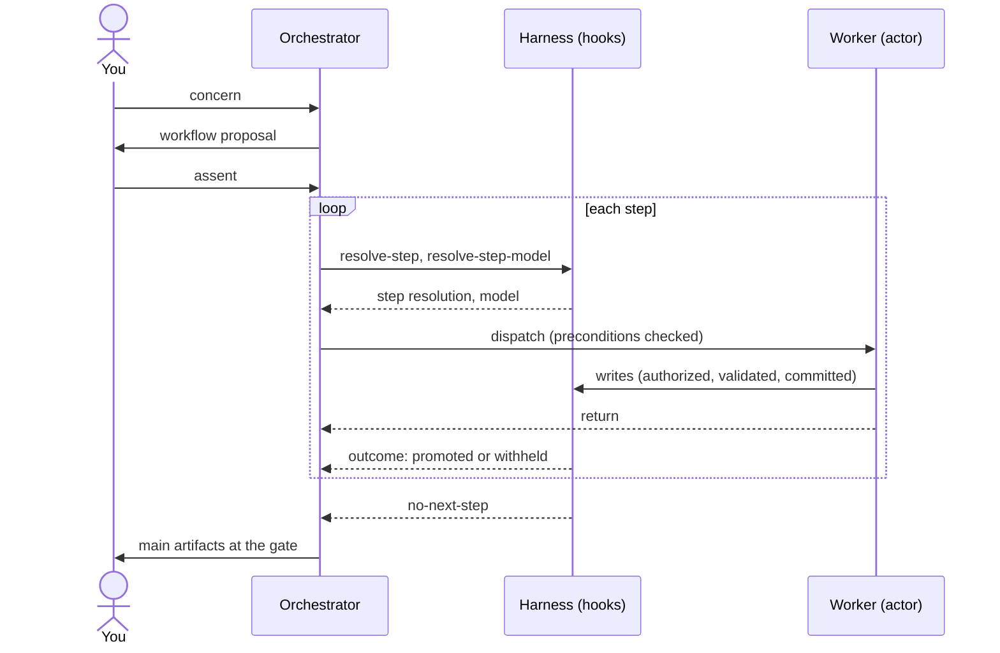

# Running workflows

{: .no_toc }

This page assumes you finished a [Quickstart](). It shows how a workflow runs, from your first request to the user gate, how to continue a workflow instance, and how to recover one that an interruption left busy.

## Table of contents

{: .no_toc .text-delta }

1. TOC
{:toc}

---

## Talk to the orchestrator of your layer

You talk to one of three orchestrators. Each one writes, or thickens, work items of its layer's grain:

| Orchestrator | Layer | Grain |
|---|---|---|
| `value-management-officer` | Portfolio | Epic |
| `release-train-engineer` | Program (ART) | Feature |
| `scrum-master` | Team | Story |

State your concern in your own words: you don't name a ceremony or a workflow. The orchestrator maps the concern to the one workflow of its layer whose purpose matches, or tells you which other orchestrator to invoke. The [SAFe Agentic Organization](#the-workflow-catalog) page lists the 25 workflows.

## Run a first workflow

Select `value-management-officer` and write, for example:

```text
I want to start a new Epic: "Build a REST API for user authentication (JWT, refresh tokens)".
```

The orchestrator maps this to the `epic-lean-business-case` workflow. Its steps, each acted by one bench agent and delivering one artifact:

| # | Step | Actor | Artifact |
|---|---|---|---|
| 1 | `draft-epic` | `business-owner` | `epic` |
| 2 | `discovery-and-draft` | `business-owner` | `lean-business-case` |
| 3 | `draft-enabler-epic` | `enterprise-architect` | `epic-enabler` |
| 4 | `challenge-feasibility` | `developer` | `feasibility-review` |
| 5 | `owner-rewrite` | `business-owner` | `lean-business-case` |
| 6 | `update-epic` | `business-owner` | `epic` |
| 7 | `update-enabler-epic` | `enterprise-architect` | `epic-enabler` |

What happens next:

1. **Assent.** The orchestrator names the workflow and asks for your assent. It starts nothing before you agree.
2. **Resolution.** The orchestrator asks the harness `resolve-step` for the workflow. The harness opens a new workflow instance (or continues the latest open one, see [below](#continue-a-workflow-instance)) and returns the next eligible step, verbatim from the workflow configuration: its actor, skills, instructions, artifact kind and conditions. The orchestrator then asks `resolve-step-model` for the model.
3. **Dispatch, one worker session per step.** The orchestrator dispatches the step to its actor, on the resolved model (`task` in the Copilot app / CLI, a subagent in VS Code). The harness checks the step's preconditions first and denies the dispatch when one fails. The worker session opens with the step's instructions and skills injected. It is the step instance: one worker session, one agent, one artifact instance.
4. **Governed writes.** Every write of the worker session is authorized, validated and committed onto its step ref (see [Write governance]()). An invalid write is reverted, and the actor is told why.
5. **Step outcome.** When the dispatch returns, the harness checks that the step instance delivered exactly one artifact instance of its declared kind and that its postconditions hold. On pass, it promotes the step instance into the workspace branch. On fail, it withholds it; the orchestrator asks `resolve-step` again, the same step comes back, and the new step instance continues the failed one's work. You don't see step retries.
6. **The user gate.** When every step has a passing step instance, `resolve-step` answers `no-next-step`. The orchestrator returns the workflow's main artifacts (here `epic`, `lean-business-case`, `epic-enabler`) and waits. You review them and accept, raise concerns, or reject. A rejection reiterates the workflow as a new workflow instance.



Agent replies and reports are indicative. The committed artifacts are the only evidence: each step appends a `stepOutcomes` entry (`written`, `revised`, `confirmed`, `no-change` or `none`) to the artifact it commits, so a step that decides "no change" still commits its decision.

## How the orchestrator asks the harness

The orchestrator asks with one plain shell command, alone in its tool call, for example on the Copilot app / CLI:

```text
& <venv python> <harness.py> resolve-step --workflow-slug epic-lean-business-case
```

(Linux and macOS: without the leading `&`.) The shell never runs that line, and no hook edits it. The harness hook recognizes the request, runs the function for the orchestrator session that the host observed, and returns the JSON report **as a hook denial** whose reason starts with `SAFe agentic harness RESULT (<function>)`. That denial is the successful answer: the orchestrator acts on it and does not re-issue the command. Only a reason starting with `SAFe agentic harness REJECTED` means the request was refused; it names the problem and the accepted line.

The orchestrator never adds `--session-id`, environment assignments, chaining or redirection. No permission rule or approval is needed, also in autopilot. Bench agents never ask the harness: an actor that tries is refused with `not-facilitator`.

## One workflow instance per orchestrator turn

On both hosts, an orchestrator session is **one turn**: it opens when you send a prompt to an orchestrator and ends when the orchestrator returns to you. A worker session opens at each dispatch and ends when the actor returns.

- An orchestrator session drives at most one workflow instance. Asking it for another workflow is refused with `session-instance-bound`, even after `no-next-step`.
- It resolves one step at a time. A second `resolve-step` while a step is in flight is refused with `step-in-flight`.
- After the gate, the organization's orchestrators name the workflow that comes next (for example `portfolio-sync` for the next product) and ask you to run it in a **new conversation**: `copilot --agent poesis-saf-agentic-organization:<orchestrator>`, or the agent picker. Reaching a ★ gate often takes several runs. Ask the orchestrator to "drive to the gate" and it answers with the plan of runs, one conversation each, and starts only the first.

## Continue a workflow instance

A workflow instance outlives its orchestrator sessions. The orchestrator may return to you before the end, for example when a precondition fails on state only you can produce: `feature-derivation` is refused while no Epic is approved. Your next prompt to the same orchestrator about the same concern opens a new orchestrator session, and `resolve-step` **continues the latest open workflow instance** of that workflow. It never replaces it: starting over a half-finished workflow instance is not supported. A step that failed comes back, and its new step instance builds on the failed step instance's step ref when the workspace branch has not moved since.

A new orchestrator session can continue a workflow instance only once the previous orchestrator session has ended or concluded its step. Otherwise `resolve-step` answers `workflow-instance-busy`.

## Recovering an interrupted workflow instance

**Symptom.** `resolve-step` answers `state-error` with code `workflow-instance-busy`, and the workflow instance stays stuck.

**Cause.** The host interrupted a run (a crash, a force-quit, a killed terminal) while an orchestrator session held an unfinished step resolution, and the end of that orchestrator session was never observed. Ending an orchestrator or worker session is best-effort, so the harness still counts that orchestrator session as the live driver of the workflow instance, and refuses every other orchestrator session.

**Find the holder.** The error message names the holding orchestrator session and prints the exact command that ends it, with the effective framework layout set in its environment. In a POSIX shell, for example:

```text
… run: FRAMEWORK_DIR=/path/to/framework FRAMEWORK_WORKSPACE_DIR=/path/to/framework/workspace … /path/to/.venv/bin/python /path/to/harness.py end-session --session-id=<holder id>
```

On Windows it is rendered for PowerShell:

```text
… run: $env:FRAMEWORK_DIR='C:\path\to\framework'; … & 'C:\path\to\.venv\Scripts\python.exe' 'C:\path\to\harness.py' 'end-session' '--session-id=<holder id>'
```

**Recover.** Only if that orchestrator session is really gone, run the printed command from your own terminal, as printed. Then retry: the next orchestrator session continues the workflow instance and resolves its unfinished step again.

**Why this is safe.** `end-session` only appends the ending entry to the holder's log. The harness refuses every later call from an ended orchestrator or worker session (`session-ended`), so even if the holder was in fact still alive, it can no longer resolve, gate or conclude a step: the new orchestrator session is the only driver of the workflow instance.

An interrupted worker session needs no manual step. Its step ref, its artifact locks and its bytes in the working tree stay in place, and the next step instance of the same step continues it.

## Where the results are

In the workspace repository:

- **Artifacts** — promoted step instances fast-forward the checked-out branch, one commit per validated write; `git log` shows them, each commit message naming its worker session.
- **Logs** — `logs/<sessionId>.log.jsonl`, one append-only file per orchestrator or worker session; each journaled harness call appends one entry. The folder is excluded from Git.
- **Harness refs** — `git for-each-ref refs/harness/` lists the step refs (every step instance's commits, promoted or not) and the artifact locks still held. They are local-only.

Push the workspace branch to share the accepted artifacts; the harness refs and logs stay on your machine.
